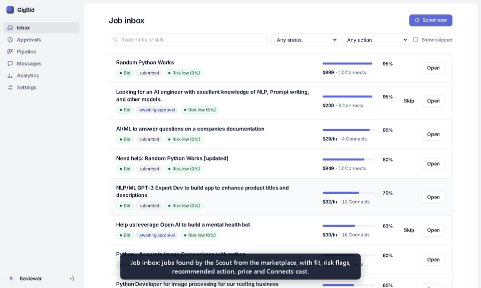
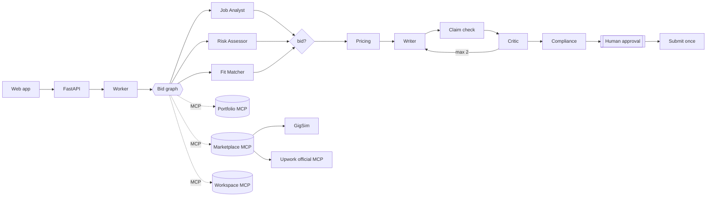

# GigBid: a multi-agent freelancer copilot

GigBid finds freelance jobs, tells you which ones are worth your Connects, and drafts proposals where every claim
links to real portfolio evidence. A team of LangGraph agents does the scanning, risk checks, matching, pricing and
writing; **you approve every proposal and message before anything leaves the system.**



**Live:** <!-- live-url -->not deployed yet<!-- /live-url --> &nbsp;·&nbsp; **Video (3 min):** <!-- video-url -->not
recorded yet<!-- /video-url --> &nbsp;·&nbsp; **Write-up:** <!-- writeup-url -->not published yet<!-- /writeup-url -->
&nbsp;·&nbsp; **Portfolio MCP server:** [install](mcp_servers/portfolio/README.md)

Reviewer login: shared privately on the submission (never in this repository).

## What it does

1. **Scouts** your saved searches on a schedule, drops duplicates and queues new jobs.
2. **Analyses each job in parallel**: a Job Analyst extracts the requirements, a Risk Assessor checks the client and
   flags scams, free-work requests, off-platform asks and injected instructions, and a Fit Matcher maps every
   requirement to evidence in your portfolio.
3. **Decides** bid, watch or skip with reasons, and prices the bid from market data, the client's history and your
   floor rate.
4. **Writes** a proposal from cited evidence, **verifies every claim** against the portfolio, lets a **Critic** send
   it back (at most twice) and runs a **Compliance Guard** over the platform rules.
5. **Stops for you**: the proposal studio shows the draft, the evidence behind each claim on hover, the risk report,
   the price rationale and a dry run of exactly what would be sent and what it costs. Approve, edit or reject.
6. **Handles replies**: classifies client messages, drafts answers and interview slots, and keeps the pipeline board
   current. Your edits and the outcomes teach GigBid your style and what wins, through explicit promotion rules.

## Architecture



More: [docs/ARCHITECTURE.md](docs/ARCHITECTURE.md), graphs rendered from code
([bid](docs/images/bid_graph.png), [conversation](docs/images/conversation_graph.png)), MCP tools in
[docs/TOOLS.md](docs/TOOLS.md), decisions in [docs/adr/](docs/adr/).

## Results

Every number below is generated from `evals/results/*.json` by `python -m scripts.make_tables`; CI fails if they are
out of sync.

### RAG: baseline against the shipped pipeline
<!-- results:main -->
_Not measured yet: run `make eval` (needs a model key)._
<!-- /results:main -->

### Retrieval variants (dev set)
<!-- results:rag -->
Unit: a portfolio project (its case study, README, code and proposals). Dev set, all three personas.

| Variant | Recall@5 | Recall@5 (capped) | MRR | nDCG@10 | p95 retrieval (s) | Jobs |
|---|---|---|---|---|---|---|
| v0 | 0.453 | 0.698 | 0.748 | 0.566 | 0.47 | 150 |
| v2 | 0.455 | 0.693 | 0.748 | 0.576 | 0.66 | 150 |
| v0+v3 | 0.460 | 0.702 | 0.734 | 0.551 | 24.05 | 150 |
| v2+v3 | 0.432 | 0.672 | 0.717 | 0.543 | 17.69 | 150 |
| v2+v4 | 0.481 | 0.725 | 0.760 | 0.597 | 4.67 | 150 |
| v2+v5 | 0.365 | 0.541 | 0.712 | 0.460 | 4.27 | 150 |
| v2+v3+v4 | 0.332 | 0.586 | 0.602 | 0.472 | 40.74 | 150 |
| v2+v3+v5 | 0.249 | 0.434 | 0.619 | 0.362 | 10.83 | 150 |
| v2+v3+v4+v5 | 0.244 | 0.438 | 0.575 | 0.341 | 10.64 | 150 |
<!-- /results:rag -->

### Multi-agent design against simpler designs (R&D question C)
<!-- results:architectures -->
_Not measured yet: run `make eval` (needs a model key)._
<!-- /results:architectures -->

### Decisions, claim verification, injection defence, budgets
<!-- results:decisions -->
_Not measured yet: run `make eval` (needs a model key)._
<!-- /results:decisions -->

<!-- results:claims -->
_Not measured yet: run `make eval` (needs a model key)._
<!-- /results:claims -->

<!-- results:injection -->
_Not measured yet: run `make eval` (needs a model key)._
<!-- /results:injection -->

<!-- results:holdout -->
_Not measured yet: run `make eval` (needs a model key)._
<!-- /results:holdout -->

Full results: [docs/RESULTS.md](docs/RESULTS.md). Public traces: <!-- traces -->added at deployment<!-- /traces -->

## Run it

```bash
cp .env.example .env          # fill APP_SECRET_KEY, MCP_SHARED_SECRET, model access; never commit .env
make up                       # web :8080, API :8000, traces :6006, GigSim, Postgres, Redis, Ollama, MCP servers
```

Development without Docker: `uv venv && uv pip install -r pyproject.toml --extra dev`, then `make test` (offline, no
API key: scripted model replies and in-memory MCP servers), `make seed` (rebuild data and indexes), `make eval`.

| Command | What it does |
|---|---|
| `make dev` | whole stack in the foreground |
| `make test` | unit, contract, integration and Playwright tests |
| `make eval` | every evaluation; writes `evals/results/*.json` |
| `make seed` | rebuild personas, GigSim seed, dev and holdout sets, indexes |
| `make demo` | one job through the single-agent demo |
| `make lint` | ruff and the web type check |

Switch to a live Upwork account: `MARKETPLACE_MODE=upwork_live`, then connect Upwork in Settings (OAuth). Every
write is a draft you confirm on Upwork.

## Models (open first)

| Profile | Frequent nodes | Writer, Critic, Liaison | Where |
|---|---|---|---|
| `open` (deployed) | gpt-oss-20b | gpt-oss-120b | hosted open-weight endpoints used as one pool (Groq, NVIDIA, Cerebras, SambaNova free tiers) |
| `open_gemma` | Gemma 4 26B-A4B | Gemma 4 31B | second open configuration, compared on the dev set |
| `open_local` | Qwen3 4B | Qwen3 8B | Ollama service in compose, no GPU needed |

No paid model is used; the whole project runs on free tiers. Cost is still reported at list price for the same
weights, so the budgets mean something at scale.

Embeddings (BAAI/bge-small-en-v1.5) and the reranker are open models on CPU in every profile.

## Data

GigSim is seeded from public Upwork job datasets on Kaggle (job text, skills, budgets, Connects costs, client
signals) plus clearly labelled synthetic data (three freelancer personas, client hidden preferences, scams, injected
posts, conversations). Sources, licenses, preprocessing and limitations: [docs/DATA_CARD.md](docs/DATA_CARD.md).

## Repository

`apps/web` React + TypeScript · `apps/api` FastAPI · `agent/` graphs, nodes, prompts, memory · `rag/` ingestion,
variants V0 to V8, claim verification · `mcp_servers/` portfolio, marketplace, workspace · `worker/` Arq schedules ·
`gigsim/` marketplace simulator · `evals/` datasets, runners, results · `infra/` Docker and deployment · `docs/`.

Pinned versions: Python 3.12, LangGraph 1.2.21, MCP SDK 1.30.0, langchain-mcp-adapters 0.3.2, FastAPI 0.162.5,
React 19, Vite, Playwright; exact pins in `pyproject.toml` and `apps/web/package.json`.

Change request (platform policy v2) absorbed with a config-only change: [docs/CHANGE_REQUEST.md](docs/CHANGE_REQUEST.md).
Signature extension X2 (proposal A/B tests): [docs/EXTENSION.md](docs/EXTENSION.md).
Operations: [docs/RUNBOOK.md](docs/RUNBOOK.md). AI usage: [docs/AI_USAGE.md](docs/AI_USAGE.md).
