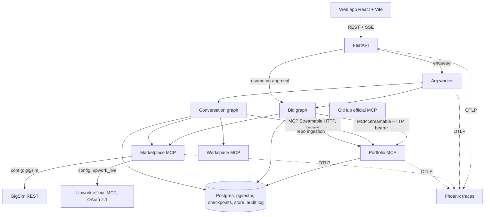

# Architecture

GigBid is a web app where a team of LangGraph agents finds freelance jobs, judges them, writes proposals grounded in
portfolio evidence and handles client conversations. A human approves every proposal, message and Connects spend.

Graphs rendered from code: [bid graph](images/bid_graph.png), [conversation graph](images/conversation_graph.png)
(`make graphs`).

## Bid graph (one thread per job)
`intake` (Scout hands the job in, duplicates stop here) -> **Job Analyst, Risk Assessor and Fit Matcher in parallel**
(`Send`) -> `decide` (skip, watch or bid, with reasons) -> Pricing Strategist -> Proposal Writer -> claim
verification -> Critic (sends the draft back at most twice) -> Compliance Guard (can block, reason shown in the UI) ->
dry-run preview -> **human approval** (`interrupt()`) -> submit exactly once. An edit is diffed for style memory and
re-checked by Compliance before it is submitted. Step and token budgets move a thread to `needs_attention`; a node
that keeps failing moves it to `dead_letter`; an unavailable marketplace moves it to `needs_attention` and the worker
re-queues it (degraded mode).

## Conversation graph (one thread per client conversation)
`load_messages` -> `classify_intent` (question, negotiation, interview request, scam signal) -> `draft_reply`
(evidence and free calendar slots through MCP) -> Compliance check -> human approval -> send exactly once, place
tentative interview holds and an email draft.

## Why each agent exists
| Agent | Why it is separate | Model (open profile) |
|---|---|---|
| Scout | Scheduled, cheap, idempotent intake and duplicate removal; no reasoning needed | none (rules) + gpt-oss-20b fallback |
| Job Analyst | Turns messy posts into a JobSpec every later step reads (requirements, screening questions) | gpt-oss-20b |
| Risk Assessor | Needs the client history tool and its own injection rules; must never be skipped by a strong fit | gpt-oss-20b + pattern rules |
| Fit Matcher | Maps each requirement to portfolio evidence; runs in parallel with the two above | gpt-oss-20b + shipped RAG |
| Pricing Strategist | Uses market statistics, client spend, the freelancer's floor and the Connects budget; the floor is a hard rule | gpt-oss-20b |
| Proposal Writer | Strongest model; writes only from cited evidence and the user's promoted style rules | gpt-oss-120b |
| Claim verification | Splits the draft into claims and removes unsupported ones before the Critic sees it | gpt-oss-20b |
| Critic | Independent check of grounding, personalisation and length; bounded loop | gpt-oss-120b |
| Compliance Guard | Policy pack rules (patterns) plus a model check; can block | gpt-oss-20b + patterns |
| Client Liaison | Conversations: intent, replies, interview slots | gpt-oss-120b |

The bid-or-skip decision itself is a deterministic rule over the three analyses (thresholds in config), so it is
explainable and cheap.

## State, execution trace and long-term memory (kept apart)
- **State** (`agent/state.py`): typed fields for the job, analyses, evidence, decision, price, drafts, critiques,
  approvals and outcomes; reducers where parallel branches write (`trace`, `tokens`, `errors`, `status`).
- **Execution trace**: every tool call, argument, result and observation goes to Phoenix (OpenTelemetry spans with
  tokens and cost per node) and to the append-only audit log; the state keeps only a per-node summary.
- **Long-term memory** (`agent/memory`): LangGraph store with two promoted namespaces. **Style memory** is learned
  from the user's edits and promoted only after the same rule appears in two separate edits (or the user pins it).
  **Outcome memory** is a per-category summary promoted only after three resolved proposals. Raw tool output never
  enters memory. The Settings screen lists both and can delete any item.

## Marketplace port
`agent/marketplace_port.py` is the only interface the graph uses. It calls the Marketplace MCP server, which routes
to the GigSim adapter or the live Upwork adapter (`mcp_servers/marketplace/adapters/`) by `marketplace.mode`. The
graph cannot tell which marketplace it is talking to. Live mode creates drafts only; the user confirms them on Upwork.

## Hand-offs
Agents exchange Pydantic objects (`agent/handoffs.py`): JobSpec, RiskReport, FitReport, BidDecision, PriceQuote,
ProposalDraft, Critique, ComplianceVerdict, MessageAnalysis, ReplyDraft.

## Stores
Postgres holds users and settings, encrypted OAuth tokens, `jobs_seen` (inbox), LangGraph checkpoints (durable
threads), the LangGraph store (memory), pgvector evidence chunks, run metrics and the append-only audit log. Redis
holds the Arq queue, the rate limiter windows and the run-progress pub/sub for streaming.
